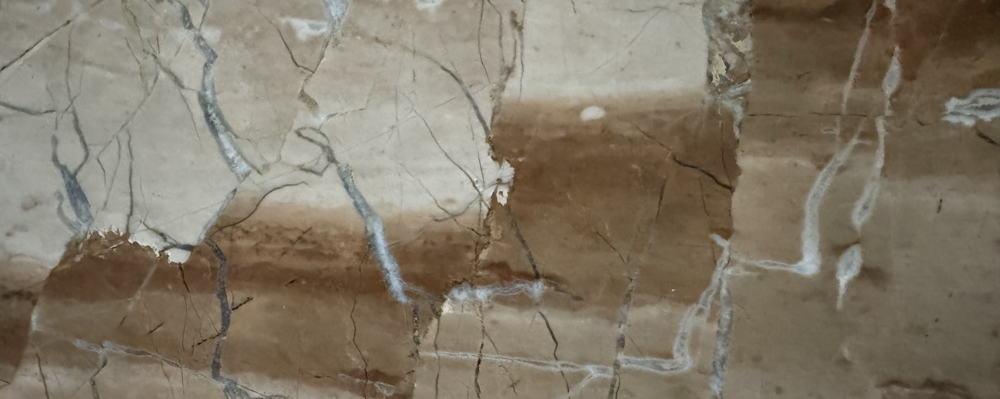

<div class="uwtn-banner"><div class="uwtn-credit">Photo by Louis Moresi</div></div>

We are going to take a look at how Underworld3 [@Moresi_2025] puts a slipping fault into a model without remeshing the whole model each time the fault moves. The mesh has to resolve the velocity discontinuity along the fault while supporting an efficient solve across the domain; the effect of the slipping fault is felt everywhere in the domain.

We divide the mesh in two. A **base** mesh holds the model's fields, particles and multigrid hierarchy. An **add-on** is a copy of its finest level with a narrow band of cells placed along the fault and split so that the two sides can slip. When the fault moves, we rebuild the add-on and reuse the base hierarchy.

The fault formulation is described in [*Faults: to mesh or not to mesh?*](https://www.underworldcode.org/putting-a-fault-in-a-mesh/) [@Moresi_2026_faults]. That note found split nodes the most efficient representation of a discontinuous, frictional fault, at the cost of cutting the mesh again whenever the fault moves; the add-on keeps that cut local. Here we concentrate on the solver: how a continuous base hierarchy and a local patch solve handle the discontinuity, and what this costs when a fault moves through a convection model. The underlying full-multigrid setup is described in [UWTN 2026-014](https://www.underworldcode.org/setting-up-full-multigrid/) [@Moresi_2026_multigrid]. The figures come from earlier development builds, with each run's commit recorded in `figures/src/`.

## The base mesh and the add-on

The base mesh covers the whole domain and has no representation of the fault. It is built and partitioned with a refinement hierarchy. Temperature, material markers and bulk history variables remain on the base; the fault's own history is stored on the fault object itself and not the extra mesh points.

Underworld fault objects already carry a discretised geometry: points along a trace in two dimensions, or a triangulated surface in three. This supplies the geometry for the add-on: a ladder-like strip of elements that we construct by replicating the fault nodes a small distance on either side of the fault itself.  This ladder can be sized to match the fault discretisation or the local base mesh.  In 3D, the construction is analogous so we'll just call it a ladder as well, though it no longer looks like a physical ladder !

The add-on mesh is a child of the base, built in three steps:

1. **Copy the base's finest level.** Away from the fault, the add-on retains the base's cells.
2. **Place the fault as a ladder.** The supplied fault points form the spine. Here they have uniform spacing $S$, and we choose to place a rail a distance $S$ on either side. The resulting two rows of squares are divided into triangles. A margin rung closes each end, and graded triangles connect the band to the remaining base cells. 
3. **Split the spine.** Interior spine vertices are duplicated and the cells on one side are connected to the copies [@Melosh_1981; @Aagaard_2013]. The fault's constitutive law couples each pair.

For this matched construction, the **band ratio** $h_b/S$ measures the ladder resolution relative to the base's finest cell size.

Our test case is a unit box in simple shear ({numref}`fig-shear-box`). The velocity $\mathbf{v} = (y - \tfrac{1}{2},\ 0)$ is imposed on all four walls, the viscosity is uniform, and a straight frictionless fault runs from $(0.30, 0.45)$ to $(0.70, 0.55)$. The base's finest cells are $h_b = 1/32$. With 80, 160 and 320 points along the fault, $S$ is 0.0052, 0.0026 and 0.0013, and the band ratio is 6, 12 and 24. With 80 points, the case drawn below, the fault adds 906 cells to the base's 2,592. The base cell count stays fixed when the fault resolution increases.

```{figure} figures/ladder-construction.png
:alt: Three parts. (a) Mesh edges near the left tip of a straight fault: a tinted band two cells wide, made of squares of side S each divided into two triangles, with the spine along the fault, a rail S either side, a rung across the band at every spine point and a margin rung one spacing beyond the tip, which is marked by an open circle; graded triangles surround the band and grow to the base cell size h_b, marked by a dimension line. (b) The same band after the split: the two copies of the spine drawn apart, one solid and marked plus, one dashed and marked minus, every interior spine vertex doubled and the tip vertex single. (c) Four panels of the multigrid hierarchy, in the same window: the split child, with its band and graded fill tinted; then the base's three levels, whose cells are h_b, 2h_b and 4h_b, with no fault in the mesh and the fault drawn as a hidden line.

The fault ladder and multigrid hierarchy, for the simple-shear box with 80 points along the fault. (a) The spine follows the fault, with rails a distance $S$ either side and graded triangles connecting the band to the base mesh. (b) The split duplicates interior spine vertices, allowing slip; the tips remain single. (c) The split child sits above the continuous base levels. The tinted cells and a surrounding layer of base cells form the patch solved exactly by the smoother.
```

The child becomes the finest multigrid level, above the base's existing levels. Model fields are interpolated onto it for the Stokes solve, and the resulting velocity is transferred back to the base for advection. Rebuilding the child leaves the base mesh and its history variables in place.

## The solve workflow

The fault object supplies the discretised trace. We choose the ladder resolution relative to that trace and the local base mesh, resampling the fault if we have to.

The algorithm is:

1. Build the base mesh and its multigrid hierarchy, and initialise the model fields and fault object.
2. Construct the add-on around the fault geometry and split it along the trace.
3. Transfer the fields needed for the Stokes solve from the base to the add-on.
4. Solve on the add-on, using the base hierarchy and an exact patch solve around the fault.
5. Transfer the velocity back to the base, advance the model and update the fault geometry. Rebuild the add-on when the fault moves.

Bulk history variables remain on the base throughout, and the fault object carries the fault's own state.

## Multigrid with a split finest level

The velocity solve uses geometric multigrid [@Briggs_2000] with the split child above the continuous base levels. Prolongation evaluates the base's finite-element field at the child's nodes. The two copies of a spine vertex therefore receive the same correction: the base can correct their mean velocity, while corrections to the slip must come from the finest-level smoother. With Galerkin coarse operators, $P^T A P$, and restriction $P^T$, the residuals at the paired vertices are summed on transfer to the base.

A pointwise smoother such as SOR is quite slow at reducing broad-scale slip errors along the fault, particularly as the band is refined. We therefore follow each SOR sweep with an exact solve on a **patch** containing the band, the graded fill, the split vertices and a surrounding layer of base cells. Patch smoothers of this kind are well established in multigrid [@Arnold_2000; @Farrell_2021]. The patch is identified from the mesh transfer and factorised by LU when the preconditioner is set up, using PETSc [@Balay_1997].

We measured velocity iterations in the simple-shear box at band ratios of 6, 12 and 24, and in a yielding-lid convection model at ratios of 8, 16 and 25. The simple-shear problem is linear: one Stokes solve, inside which the velocity block is solved 17 times as the pressure iteration converges [@May_2008]. The yielding lid [@Moresi_1998] is a 4 × 1 box with a fault through the lid, solved on four processes from rest at a state where the lid is mobilising. Each velocity Krylov iteration uses one full-multigrid cycle.

```{figure} figures/shear-box.png
:label: fig-shear-box
:width: 60%
:alt: A unit square. Arrows on the walls show simple shear: along the top wall pointing right, along the bottom wall pointing left, and on the side walls a linear profile that changes direction at mid-height. A short straight fault crosses the middle of the box, rising gently from (0.30, 0.45) to (0.70, 0.55), with its two end points marked and labelled; a narrow tinted band along it marks the ladder.

The simple-shear test. The wall velocity $\mathbf{v} = (y - \tfrac{1}{2},\ 0)$ shears the box; the frictionless fault, drawn with its ladder band exaggerated in width, slips in response.
```

| Smoother on the child | Simple shear: iterations per velocity solve (mean of 17, serial), ratios 6, 12, 24 | Yielding lid: velocity iterations per Newton iteration, ratios 8, 16, 25 |
|---|---|---|
| SOR, then patch LU | 3.9, 3.8, 3.9 | 7, 7, 7 |
| SOR, then patch ILU(0) | 10.6, 15.2, 20.2 | 28–200, 73–200, 86–200 |
| SOR | 15.2, 21.7, 31.3 | 161–175 at ratio 16 |

With an exact patch solve, the iteration count stays constant across the tested band ratios in both problems. Incomplete factorisation [@Saad_2003] increases the count, with one yielding-lid solve at each ratio reaching the limit of 200 iterations. SOR alone is also increasingly expensive. Peak slip agrees within solver tolerance across the tests.

The exact patch solve also saves time. In the simple-shear box, a serial solve on the already-assembled operators took 0.8, 1.0 and 1.6 s with LU on the patch, against 1.9, 3.1 and 5.5 s with ILU(0) and 2.2, 3.5 and 6.1 s with SOR alone. These are laptop timings and indicative only; the iteration counts are the firmer measure.

For curved free-slip walls, each multigrid level also uses its own wall-normal frame, as described in [UWTN 2026-016](https://www.underworldcode.org/boundary-conditions-on-non-planar-boundaries/) [@Moresi_2026_boundaries].

## Following a trench

Our moving-fault example is a subducting plate in a mantle-depth annulus, with free-slip walls, basal and internal heating, and a continent behind the incoming plate. An 11 km melange layer marks the plate interface [@Sandiford_2019]. A frictionless fault follows its base [@Zhong_1995], with a weak zone continuing the fault to the surface. The melange itself is a passive marker in this run. We use the model here to demonstrate the numerical method; the subduction science is still being developed.

```{figure} figures/annulus-movie.mp4
:label: fig-annulus-movie
:placeholder: figures/annulus-movie-still.png
:alt: Movie in two panels over 800 steps. On the left, the whole annulus coloured by temperature, with a cold lid at the surface. A slab sinks from a trench near the top, reaches the bottom of the mantle and spreads along it, and thin hot plumes rise from the base as the run goes on. Outside the surface, a black arc grows clockwise from a tick marked start as the trench rolls back, and the centre of the annulus reads the rollback in km and degrees, 2,228 km at the furthest. A box marks the window shown on the right. On the right, a close-up of the trench, in which the slab descends steeply beneath a thin green melange layer and a black fault, with streamlines of the flow, and above it a line plot of the surface velocity across the trench.

The trench run, 3–1,103 Myr. Left: the annulus, with the initial trench at the top and the black arc marking rollback. Right: a view centred on the moving trench, with surface velocity above it. Temperature runs from blue (cold) to red (hot); green marks the melange layer, orange the oceanic crust and black the fault. The PDF shows step 460, at maximum rollback.
```

A fault is both a material interface and also the location of discontinuous slip. Numerically, these two can drift apart during advection, so we reposition the model fault consistently by fitting its trace to material markers.

The base's finest cells are about 45 km across, with ladder rungs 22.7 km apart: a band ratio of 2. As the trench moves, we rebuild the child around the fitted trace and reuse the base hierarchy. The trench rolls back 2,228 km by step 460, then advances again before the run ends at step 799. The band adds only 249–332 cells to the base's 126,976 cells. The [mesh movie](figures/trench-movie.mp4) and [four snapshots](figures/trench-mesh.png) show the band following the fault through the fixed base mesh.

On 26 processes, a step took 99 s on average, excluding a further 16 s for checkpoint output. The Stokes solve accounted for 82 s. Building the child took 4.4 s, transferring fields onto it 2.8 s and transferring the solution back 2.7 s: together about 10 per cent of the step. The run averaged seven nonlinear iterations per step; the final velocity and pressure solves of each step averaged 4.5 and 12 iterations respectively. No linear solve reached its iteration limit. Relative tolerances were $10^{-3}$ for Stokes, $10^{-2}$ for pressure ($10^{-4}$ on the first solve) and $3.3 \times 10^{-5}$ for velocity.

```{figure} figures/trench-cost-window.png
:label: fig-trench-cost
:alt: Three panels against step, 2 to 141. (a) Stokes wall time per nonlinear iteration, scattered between about 6 and 16 seconds around a dashed mean of 11.0 seconds, with no trend. (b) Velocity iterations of every linear solve as points, mostly between 1 and 8, with a line for the mean over each step that stays near 4. (c) Bars of nonlinear iterations per step, between 3 and 19.

The solver cost while following the trench, steps 2 to 141 on 26 processes, with the add-on rebuilt at every step. (a) Stokes wall time per nonlinear iteration: 11.0 ± 1.8 s. (b) Velocity iterations of each linear solve, with the mean over each step: 4.2 on average over 1,289 solves. (c) Nonlinear iterations per step, which set the step-to-step variation in cost.
```

## Current limits

Individual fault ladders cannot cross in our formulation, so junctions retain a gap between bands. At a domain boundary the split stops short of the wall; the trench example continues it to the surface with a weak zone. The efficiency measurements here are two-dimensional. The cost of factorising a patch around a fault surface in three dimensions remains to be measured.

<!-- uwtn-acknowledgement -->

*The Underworld project is supported by AuScope and the Australian Government through the National Collaborative Research Infrastructure Strategy (NCRIS). Source code:* [*github.com/underworldcode/underworld3*](https://github.com/underworldcode/underworld3)

*This research was supported by the Australian Government's National Collaborative Research Infrastructure Strategy (NCRIS), with access to computational resources provided by the National Computational Infrastructure (NCI Australia) through the National Computational Merit Allocation Scheme and the ANU Merit Allocation Scheme.*

<!-- uwtn-acknowledgement -->

<div class="uwtn-discuss"><div class="uwtn-discuss-head">Comments</div><div class="uwtn-discuss-body">Discussion of these notes happens in GitHub Discussions, so it stays with the source and is searchable alongside it.</div><div class="uwtn-discuss-links"><a href="https://github.com/Underworld-Technical-Notes/underworldcode.org/discussions?discussions_q=faults-on-an-add-on-mesh">Read the discussion</a><a href="https://github.com/Underworld-Technical-Notes/underworldcode.org/discussions/new?category=general&title=faults-on-an-add-on-mesh">Start one</a></div></div>
