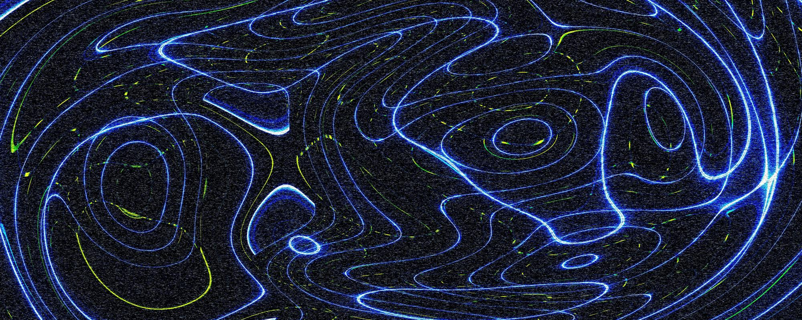

<div class="uwtn-banner"><div class="uwtn-credit">Photo by <a href="https://unsplash.com/@loganvoss?utm_source=underworld-technical-notes&utm_medium=referral&utm_campaign=api-credit">Logan Voss</a> / <a href="https://unsplash.com/?utm_source=underworld-technical-notes&utm_medium=referral&utm_campaign=api-credit">Unsplash</a></div></div>

In this article, we will see how the underworld3 sympy formulation combined with the PETSc finite element, strong-form framework builds model derivatives which can solve non-linear problems using a Newton method. This requires us to calculate the local derivative of the model with respect to the unknowns so that we know the direction to move towards a better solution.

If we differentiate the prediction a model makes with respect to one of its parameters, then we can determine how sensitive the prediction is to changes in that parameter and therefore whether the model can be used to constrain the value of that parameter. Similarly, model derivatives are used in data assimilation to determine how to adjust a model's parameters so it better fits the observations we have [@Bunge_2003; @Liu_2008].

## The forward problem, solved by Newton

Underworld3 starts from the strong form of the equations which is usually how they are written in a textbook or a paper. These are symbolic, sympy objects that pass directly to compiled objects in PETSc  [@Moresi_2025; @Knepley_2013]: everything
inside a divergence term goes into the flux $\mathbf F_1$, everything else into the
force $F_0$. The discrete solution is written in the finite-element basis,
$u = \sum_j u_j \phi_j$, and the weak form is one equation for each basis
function $\phi_i$: the integral of the two templates against it and its
gradient,

```{math}
:label: eq-residual
R_i(u;\, m) \;=\;
\int_\Omega F_0(u, \nabla u;\, m)\,\phi_i
\;+\; \mathbf F_1(u, \nabla u;\, m) \cdot \nabla\phi_i \;=\; 0 .
```
$R$, the residual {eq}`eq-residual`, is the **out-of-balance force**: what the
assembled system has left over when the current $u$ is put into the governing
equation. A solution is a $u$ that makes it vanish. Here $m$ is a set of parameters of the model (for example a Rayleigh number, or a constitutive modulus) that the user typically would adjust to run an example. 

A Newton non-linear solver needs the derivative of $R$ with respect to the unknowns
[@Moresi_2026_sympy]:

```{math}
:label: eq-blocks
G_0 = \frac{\partial F_0}{\partial u}, \quad
G_1 = \frac{\partial F_0}{\partial (\nabla u)}, \quad
G_2 = \frac{\partial \mathbf F_1}{\partial u}, \quad
G_3 = \frac{\partial \mathbf F_1}{\partial (\nabla u)} ,
```

which underworld computes directly from sympy, compiles and registers with PETSc. The Jacobian is the derivative of each equation $R_i$ with respect to each nodal unknown $u_j$. Since $\partial u/\partial u_j = \phi_j$ and $\partial (\nabla u)/\partial u_j = \nabla\phi_j$, the chain rule turns the four blocks into $K_{ij} = \partial R_i/\partial u_j$, assembled element by element,

```{math}
:label: eq-jacobian
K_{ij} = \int_\Omega
\phi_i \, G_0 \, \phi_j
\;+\; \phi_i \, G_1 \cdot \nabla\phi_j
\;+\; \nabla\phi_i \cdot G_2 \, \phi_j
\;+\; \nabla\phi_i \cdot G_3 \cdot \nabla\phi_j .
```

$K = \partial R/\partial u$, assembled by {eq}`eq-jacobian`, is the **tangent
stiffness matrix**. For a linear problem it is just the stiffness matrix,
and 

```{math}
:label: eq-stiffness
R = Ku - f
```

For a nonlinear problem, $K(u)$ is the stiffness of the material at
the current solution state. Newton uses it to reduce the out-of-balance
force: expanding $R(u + \delta u) \approx R(u) + K\,\delta u$ and asking for
the left side to vanish gives the correction

```{math}
:label: eq-newton
K\,\delta u = -R(u), \qquad u \leftarrow u + \delta u ,
```

repeated until $R$ is zero to the tolerance asked for. For a linear problem
{eq}`eq-stiffness` makes the expansion exact, and one step gives the solution.

## The adjoint problem

Now suppose we want to choose the parameters $m$ so that the model reproduces
some observations as well as it can. The observations are values 
$d_i^{\mathrm{obs}}$ — a surface velocity at a station, or a stress at a point —
and the model predicts the same quantities, $d_i(u)$, from its solution. The
quality of the fit is the misfit

```{math}
:label: eq-misfit
J(u) = \frac12 \sum_i \big(d_i(u) - d_i^{\mathrm{obs}}\big)^2 ,
```

and the task is to minimise this by adjusting $m$, under the
constraint that $u$ always solves the model: $R(u;\, m) = 0$ at every $m$ we
try. To do that we need the gradient $\mathrm dJ/\mathrm dm$  (which way, and
how far, to move each parameter) and the adjoint approach provides this for
all the parameters at once - at the expense of one additional *linear* solve. 

```{figure} figures/misfit-surface.svg
:name: fig-misfit-surface
:width: 70%
:alt: A bowl-shaped surface drawn as a grid above the parameter plane with axes m_1 to the right, m_2 towards the rear, and J upward. A red dot on the surface labelled J(m) marks the current parameters, with a dashed vertical line down to the plane beneath it. The tangent plane touches the surface at the dot, and a rust arrow labelled minus grad J points down the slope from it. A dashed line with small open circles runs from the dot down the bowl to a black dot at its lowest point, labelled m-star.

The misfit $J$ as a surface over two parameters (in this case). A forward solve locates the model at one point on this surface. The adjoint solve gives the tangent plane at that location. Following the gradient downhill reaches $m^*$, where the model best fits the observations.
```

The constraint is added to the minimisation with a Lagrange multiplier
$\mu$ [@Plessix_2006]:

```{math}
:label: eq-lagrangian
\mathcal L(u, \mu;\, m) = J(u;\, m) + \mu^{T} R(u;\, m) ,
```

which equals $J$ for any $\mu$ whenever the model is solved, because $R = 0$
there. We are free to choose $\mu$, and we choose it so that $\mathcal L$ does
not change, to first order, when the solution changes:
$\partial\mathcal L/\partial u = \partial J/\partial u + \mu^{T}K = 0$.
Transposed, that is the **adjoint problem**,

```{math}
:label: eq-adjoint
K^{T}\mu = -\Big(\frac{\partial J}{\partial u}\Big)^{T},
```

a linear solve for a field $\mu$ on the same mesh as $u$. It is linear because
$u$ is already known: $K$ and $\partial J/\partial u$ are evaluated at the
converged solution and held fixed, and $\mu$ appears only multiplied by them.
The operator is the tangent stiffness $K$ at that solution, transposed. The
force is the
misfit's derivative with respect to the solution,

```{math}
:label: eq-djdu
\frac{\partial J}{\partial u_j}
= \sum_i \big(d_i(u) - d_i^{\mathrm{obs}}\big)\,\frac{\partial d_i}{\partial u_j} ,
```

one entry per nodal unknown: each misfit $d_i - d_i^{\mathrm{obs}}$, placed at
the nodes its prediction depends on. This is **the misfit written as a force**,
assembled like any finite-element force vector, and it is the only place the
observations enter. With $\mu$ chosen this way, the solution's response to $m$ drops out of
$\mathrm d\mathcal L/\mathrm dm$, and what is left is the gradient for each
parameter,

```{math}
:label: eq-gradient
\frac{\mathrm d J}{\mathrm d m_k} = \frac{\partial J}{\partial m_k} + \mu^{T}\frac{\partial R}{\partial m_k} ,
```

where $\partial R/\partial m_k$ is a **pseudo-force**: the out-of-balance
force that appears when $m_k$ is nudged and the solution held still. It is
an integral for each parameter, not a solve.

[The appendix](#sec-derivation) reaches {eq}`eq-adjoint` and
{eq}`eq-gradient` a second way, by differentiating the constraint directly,
which shows what each term means.

Reducing $J$ is then a loop, [](#fig-adjoint-loop): (1) solve the model,
(2) solve the adjoint problem, (3) form the gradient for every parameter,
(4) update the parameters and go round again. In practice a quasi-Newton method such as
L-BFGS chooses the step $\alpha$ and builds up curvature from successive
gradients.

```{figure} figures/adjoint-loop.svg
:name: fig-adjoint-loop
:width: 78%
:alt: Four rounded boxes in a square, numbered 1 to 4 and joined by arrows running clockwise. Top left, 1. Solve the model, R(u; m) = 0 by Newton. An arrow labelled K leads right to 2. Solve the adjoint, K-transpose mu equals minus the transpose of dJ/du, into which a heavier rust-coloured arrow labelled dJ/du comes down from the words observations d-obs above. A teal arrow labelled mu leads down to 3. Form the gradient, dJ/dm_k as an integral. An arrow labelled dJ/dm leads left to 4. Update the parameters, m becomes m minus alpha grad J, and an arrow labelled m leads up to close the loop. A dashed rust-coloured arrow labelled dR/dm_k runs diagonally from the model box to the gradient box.

One pass of an inversion. Teal carries a field, rust a force, black a quantity handed on. The tangent stiffness $K$ assembled by the forward solve is the operator of the adjoint solve, and the pseudo-force $\partial R/\partial m_k$ comes from the same residual; the observations enter only as the adjoint's load.
```

Each pass costs one nonlinear solve and one linear one, irrespective of the number of
parameters there are, and the fit improves until the gradient vanishes, at a
minimum of $J$ where no small change of $m$ brings the model closer to the
observations. The minimum may be a local one: the gradient describes the
surface only where the model is. In
Underworld3, with the misfit `J` written as an integrand over the mesh,
steps 2 and 3 are a single call,

```python
dJdm = stokes.gradient(J, parameters=[m1, m2, m3])["parameters"]
dJdm[m1]                       # dJ/dm1
```

and step 4 is whatever optimiser one prefers.

## Re-using the forward solve

The adjoint problem {eq}`eq-adjoint` asks for two things: the transposed stiffness $K^{T}$, and the pseudo-force $\partial R/\partial m$. Neither is a new object. Both are the blocks {eq}`eq-blocks` that Newton already uses, read differently.

**The transposed stiffness is a relabelling.** $K^{T}$ is the bilinear form of
{eq}`eq-jacobian` with trial and test exchanged. Exchanging $\phi_i$ and
$\phi_j$ leaves the two diagonal terms in place, transposed on their paired
indices, and swaps the two mixed ones — the $G_1$ term becomes a $G_2$ term
and the other way about, with their components exchanged:

```{math}
:label: eq-transpose
G_0 \;\rightarrow\; G_0^{T}, \qquad
G_3 \;\rightarrow\; G_3^{T}, \qquad
G_1 \;\rightarrow\; G_2^{T}, \qquad
G_2 \;\rightarrow\; G_1^{T} .
```

So the adjoint operator is assembled from the *same four compiled kernels*,
registered in a different arrangement. We do that wherever the kernels carry
the whole operator, rather than transposing an assembled matrix, which matters
for Stokes, where the $(u,p)$ and $(p,u)$ blocks exchange places by the same
rule and the composite operator stays a composite operator the Krylov solver
can be preconditioned against. Nothing is differentiated a second time, and the
assembled operator agrees with the explicit transpose to machine precision.

**The parameter derivative is the same `diff`, on a different symbol.**
A named quantity $m$ — a friction coefficient, a reference viscosity, a
continuation parameter — survives into $F_0$ and $\mathbf F_1$ as a symbol,
because the solver carries the constitutive model's own expression rather than
the number it currently holds. Differentiating {eq}`eq-residual` with respect
to $m$ instead of $u$ is the same operation that produced {eq}`eq-blocks`:

```{math}
:label: eq-drdm
\frac{\partial R}{\partial m} \;=\;
\int_\Omega \frac{\partial F_0}{\partial m}\,\phi
\;+\; \frac{\partial \mathbf F_1}{\partial m}\cdot\nabla\phi .
```

## Accuracy of the gradient

Three things decide the accuracy of the gradient. The forward solve must be converged before
the adjoint is taken, because $\mu$ is the multiplier for the constraint
$R = 0$ and has meaning only where that holds. The adjoint solve itself can be
run to a loose tolerance: every pass re-solves the forward problem and
recomputes $J$, so a direction that is slightly off costs an extra iteration
and the next misfit shows whether it helped. And the matrix must be the true
derivative $\partial R/\partial u$. With a frozen-viscosity Picard matrix, $\mu$
solves its own equation exactly and the gradient it gives belongs to no
function, so the optimiser can stop where the true gradient is still large.
The tangent is a property of the code rather than of the iterate, so it is
checked once, by finite differences, and assembling it symbolically from the
same residual is what makes it right by construction.

+++ {"part": "appendix"}

(sec-derivation)=
## Derivation of the adjoint

The adjoint problem {eq}`eq-adjoint` and the gradient {eq}`eq-gradient` also
follow from differentiating the constraint directly, without the Lagrangian
{eq}`eq-lagrangian`, and this route shows what each term means.

We explicitly wrote $R$ in terms of $m$ to demonstrate that there is an entire family of solutions to $R=0$ that we can access by changing the model's free parameters. If the model makes a prediction, $J(u)$, we can ask how changing $m$ affects that prediction (the sensitivity of the prediction to $m$). That is

```{math}
:label: eq-question
\frac{\mathrm d J}{\mathrm d m}
```

If $J$ is an underworld function then we can form a symbolic expression. First we note that $u$ and $m$ are not independent: the solution is constrained to the family of solutions of {eq}`eq-residual`, $R = 0$ holds *for every* $m$ and, because of this, $dR/dm$ is zero too

```{math}
:label: eq-total
\frac{\mathrm d R}{\mathrm d m}
= \frac{\partial R}{\partial u}\frac{\mathrm d u}{\mathrm d m}
+ \frac{\partial R}{\partial m} = 0 .
```

The first factor is the tangent stiffness $K$ again, so

```{math}
:label: eq-implicit
K\,\frac{\mathrm d u}{\mathrm d m} = -\frac{\partial R}{\partial m},
\qquad \text{so} \qquad
\frac{\mathrm d u}{\mathrm d m} = -K^{-1}\frac{\partial R}{\partial m},
```

$\partial R/\partial m$ is the pseudo-force of {eq}`eq-gradient`: the out-of-balance force that
appears if the parameter is nudged and the solution is held still. It is
assembled exactly as $R$ is, with $\partial F_0/\partial m$ and
$\partial \mathbf F_1/\partial m$ in place of $F_0$ and $\mathbf F_1$.

We interpret {eq}`eq-implicit` as: **the sensitivity of the
solution to a parameter is the response of the structure to that parameter's
pseudo-force.** 

The prediction depends on $m$ in the same two ways: directly, and through the
solution. With $\partial J/\partial u$ the row of derivatives
$\partial J/\partial u_j$ with respect to the nodal unknowns — the prediction
written as a force — the chain rule and {eq}`eq-implicit` give

```{math}
:label: eq-chain
\frac{\mathrm d J}{\mathrm d m}
= \frac{\partial J}{\partial m}
+ \frac{\partial J}{\partial u}\frac{\mathrm d u}{\mathrm d m}
= \frac{\partial J}{\partial m}
- \frac{\partial J}{\partial u}\,K^{-1}\frac{\partial R}{\partial m} .
```

### Many parameters at once

A real model has many parameters, $m_1, \dots, m_N$, and we want the
sensitivity for all of them. We first write {eq}`eq-chain` like this:

```{math}
:label: eq-chain-k
\frac{\mathrm d J}{\mathrm d m_k}
= \frac{\partial J}{\partial m_k}
- \frac{\partial J}{\partial u}\,K^{-1}\,\frac{\partial R}{\partial m_k},
\qquad k = 1, \dots, N .
```

These are $N$ equations that differ only in their last factor, the pseudo-force $\partial R/\partial m_k$. The row in front of it, $\big(\partial J/\partial u\big)K^{-1}$, contains the prediction and the stiffness but no parameter; it is the same for every $k$ and we only need to compute it once. 

Now define $\mu$ through

```{math}
:label: eq-mu-row
\mu^{T} = -\frac{\partial J}{\partial u}\,K^{-1} .
```

We do not have access to $K^{-1}$ so we multiply both sides by $K$ on
the right, take the transpose and substitute into {eq}`eq-chain-k`
to recover {eq}`eq-adjoint`:

```{math}
K^{T}\mu = -\Big(\frac{\partial J}{\partial u}\Big)^{T}, \qquad
\frac{\mathrm d J}{\mathrm d m_k} = \frac{\partial J}{\partial m_k} + \mu^{T}\frac{\partial R}{\partial m_k} .
```

One linear solve for $\mu$, whatever $N$ is, and then one product for each
parameter. Written as fields, with $\mu = \sum_i \mu_i \phi_i$, that product is

```{math}
:label: eq-mu-test
\mu^{T}\frac{\partial R}{\partial m_k}
= \int_\Omega \frac{\partial F_0}{\partial m_k}\,\mu
\;+\; \frac{\partial \mathbf F_1}{\partial m_k}\cdot\nabla\mu ,
```

which is the pseudo-force's weak form with $\mu$ in the place of the test function. 

$\mu$, the **adjoint state**, is the response of the same structure to the
misfit's force: an influence field, in the sense of an influence line. It says
how strongly an out-of-balance force applied anywhere in the domain would tell
on the misfit. With it in hand, the derivative for a parameter is
$\mu^{T}\partial R/\partial m$ — the virtual work that parameter's pseudo-force
does against the influence field — and that is an integral, not a solve.

Solving {eq}`eq-implicit` for each $\mathrm d u/\mathrm d m_k$ and contracting it
with $\partial J/\partial u$ gives the same numbers, at the cost of $N$ solves.
That the two agree is Maxwell–Betti reciprocity: the
work done by one force through the displacements of another equals the work
done by the second through the displacements of the first. The transpose is
what makes it true for a problem whose stiffness is not symmetric.

So the adjoint is cheap in parameters and dear in misfits. One solve for ten
parameters or a thousand; another solve for every additional misfit. That
suits a model with many dials and one thing you care about, which is the usual
shape of the problem.

### One stiffness, three forces

The Newton update, the forward sensitivity and the adjoint are three linear
solves with the same matrix and different right-hand sides:

```{math}
:label: eq-family
K\,\delta u = -R, \qquad\quad
K\,\frac{\mathrm d u}{\mathrm d m} = -\frac{\partial R}{\partial m},
\qquad\quad
K^{T}\mu = -\Big(\frac{\partial J}{\partial u}\Big)^{T} .
```

Newton has already assembled and preconditioned that matrix, so the adjoint
costs one more linear solve.

+++

<!-- uwtn-acknowledgement -->

*The Underworld project is supported by AuScope and the Australian Government through the National Collaborative Research Infrastructure Strategy (NCRIS). Source code:* [*github.com/underworldcode/underworld3*](https://github.com/underworldcode/underworld3)

<!-- uwtn-acknowledgement -->

<div class="uwtn-discuss"><div class="uwtn-discuss-head">Comments</div><div class="uwtn-discuss-body">Discussion of these notes happens in GitHub Discussions, so it stays with the source and is searchable alongside it.</div><div class="uwtn-discuss-links"><a href="https://github.com/Underworld-Technical-Notes/underworldcode.org/discussions?discussions_q=symbolic-fem-and-adjoint-forms">Read the discussion</a><a href="https://github.com/Underworld-Technical-Notes/underworldcode.org/discussions/new?category=general&title=symbolic-fem-and-adjoint-forms">Start one</a></div></div>
